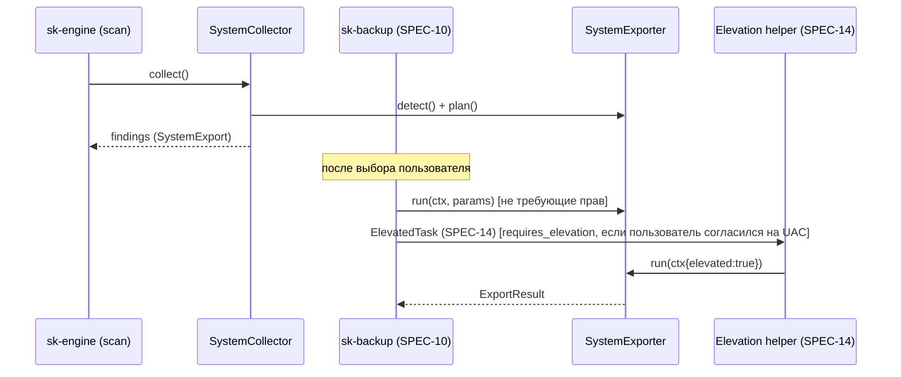

# SPEC-06: Системные экспорты

| Поле | Значение |
|---|---|
| ID | SPEC-06 |
| Статус | in-progress |
| Фаза | P1 |
| Крейт(ы) | `sk-system` |
| Зависит от | SPEC-01, SPEC-02, SPEC-03 |
| Используется в | SPEC-04 (`installed` условие), SPEC-09, SPEC-10 (выполнение экспортов), SPEC-13, SPEC-14 (elevation-хелпер) |
| Последнее изменение | 2026-10-10 (§4.7: источники фактов чек-листа — `params` от SPEC-10, соседние папки экспортов, `installed_programs`; тексты из `app/src/i18n` — T-06-11); 2026-10-10 (T-06-10: условия и детали fallback-сериализатора в §4.5); 2026-10-10 (T-06-09: детали `drivers`, `printers`, `disks-info`, `windows-info` в §4.3); 2026-10-10 (копирующие экспортёры не открывают cloud-only файлы — SPEC-10 FR-10-15, задача T-06-17; экспорт задач планировщика через COM — §9); 2026-10-10 (T-06-08: детали `fonts`, `hosts`, `scheduled-tasks`, `powershell-modules` в §4.3); 2026-10-10 (SPEC-02 T-02-11: `env-vars` читает значения через `RegistryReader::values`, крайние случаи вывода в §4.3); 2026-10-10 (T-06-07: детали `wifi` в §4.3); 2026-10-10 (решения по итогам T-06-03..07: detect `wifi` по папке профилей §4.3/§5; исключение FR-06-01 для `winget`; `ExportContext.config` и `enrich_with_registry` в §4.1; расширенный фильтр MSIX §4.4; `env-vars` и T-06-10 через `RegistryReader::values` (SPEC-02 §3.4); задачи T-06-14..16; i18n ключей sk-system в T-06-11); 2026-10-10 (T-06-06: детали `export_registry`, `registry-user`, `env-vars` в §4.3); 2026-10-10 (T-06-05: детали `winget`/`programs` в §4.3); 2026-10-09 (T-06-04: конструкторы `SystemCollector` в §4.1; §4.8 приведён к принятому в §9 `system.disabled_exporters`); 2026-10-04 (T-06-02: API `Cmd`/`CmdOutput` в §4.1, FFI в `sk-core::win::process`, cp437 и `truncated` в §4.6; статус in-progress — T-06-01); 2026-10-03 (T-02-10: общий RegistryReader и PathTemplate::specialize в sk-core; §4.4: чтение Uninstall через `RegistryReader`, T-06-03 зависит от T-02-10); 2026-10-01 (решение по OEM-ключу) |

## 1. Цель

Сохранить системное состояние, которое нельзя получить простым копированием
пользовательских файлов: список программ для переустановки, ветки реестра, профили
Wi-Fi, драйверы, шрифты, hosts, переменные окружения, задачи планировщика и т.д. Плюс
сформировать **чек-лист** того, что не экспортируется файлами (лицензии, BitLocker, 2FA).
На скане экспортёры только определяют доступность и планируют находку. Сам экспорт
выполняется при бэкапе (SPEC-10).

## 2. Область

### 2.1 Входит
- Трейт `SystemExporter` и реестр экспортёров.
- `SystemCollector: Collector` (detect + plan).
- Сбор `Environment.installed_programs` (обогатитель в фазе Environment).
- Выполнение экспортов в каталог (`run`) — вызывается из SPEC-10.
- Запуск внешних процессов: таймауты, кодировки, без окна консоли.
- Чек-лист ручных действий (`checklist.md` в бэкапе).

### 2.2 Не входит
- Реестр конкретных программ (7-Zip, PuTTY): правила SPEC-04 с `Target::Registry`. Их экспорт выполняет **этот** крейт (`export_registry`, §4.5), SPEC-10 его вызывает.
- Восстановление (`winget import`, `netsh add profile`): SPEC-13.
- Механизм повышения прав (процесс-хелпер): SPEC-14. Здесь только контракт.

## 3. Требования

### 3.1 Функциональные
- **FR-06-01** — Каждый экспортёр реализует `detect()` (быстро, ≤ 500 мс, без побочных эффектов; исключение — `winget`: `winget --version` с таймаутом 2 с из-за холодного старта алиаса App Installer) и `plan()` (находка `Target::SystemExport`).
- **FR-06-02** — `run()` пишет результат **только** в переданный `target_dir` (P1) и возвращает список созданных файлов с хэшами.
- **FR-06-03** — Экспортёры, которым нужен админ, возвращают `Availability::NeedsElevation`, их находки получают `requires_elevation: true`. При бэкапе без прав они выполняются через хелпер (SPEC-14) или пропускаются с понятным сообщением.
- **FR-06-04** — Все внешние процессы запускаются с `CREATE_NO_WINDOW`, с таймаутом (по умолчанию 60 с, для драйверов 600 с), с отменой (kill дерева через Job Object) и с корректным декодированием вывода (§4.6).
- **FR-06-05** — Никакие ключи продуктов и лицензии не извлекаются (P6). OEM-ключ из BIOS тоже не извлекается: `windows-info` записывает только факт его наличия (`oem_key_in_firmware: true`), а `checklist.md` поясняет, что активация пройдёт автоматически.
- **FR-06-06** — Экспорт паролей Wi-Fi открытым текстом (`key=clear`) выполняется **только** при явном согласии в UI (чекбокс в находке, `params.include_keys = true`). Такая находка получает `sensitivity: High` и рекомендацию шифрования бэкапа (SPEC-10).
- **FR-06-07** — Список установленных программ собирается всегда (даже без winget) из Uninstall-ключей и сохраняется как `programs.csv` + `programs.html` (с поиском). Это база для ручной переустановки.
- **FR-06-08** — Чек-лист `checklist.md` генерируется всегда. В нём отмечено, что найдено (например, «BitLocker включён на C: — сохраните ключ восстановления из аккаунта Microsoft»).

### 3.2 Нефункциональные
- **NFR-06-01** — Весь `SystemCollector` на скане ≤ 3 с (без `winget export`, только `detect`).
- **NFR-06-02** — Независимость от локали Windows: не парсим локализованный вывод команд, где есть альтернатива (реестр/WMI/XML). Где нет, парсим только структурные части.

## 4. Дизайн

### 4.1 Публичный API

```rust
#[async_trait]
pub trait SystemExporter: Send + Sync {
    fn id(&self) -> &'static str;                       // "winget", "programs", "wifi", ...
    fn detect(&self, env: &Environment) -> Availability;
    fn plan(&self, env: &Environment, avail: &Availability) -> Option<Finding>;
    async fn run(&self, ctx: &ExportContext, params: &serde_json::Value) -> Result<ExportResult, ExportError>;
}

pub enum Availability {
    Available { estimated_bytes: Option<u64>, details: BTreeMap<String, String> },
    NeedsElevation { estimated_bytes: Option<u64> },
    Unavailable { reason_key: String },                 // winget не установлен и т.п. — находка не создаётся
}

pub struct ExportContext<'a> {
    pub env: &'a Environment,
    pub target_dir: &'a Path,                           // <backup>/system/<exporter_id>/
    pub cancel: &'a CancellationToken,
    pub events: &'a EventSink,
    pub elevated: bool,                                 // выполняемся ли в хелпере с правами
    pub config: &'a SystemConfig,                       // sk_core::config, секция `system` (SPEC-01 §4.8.2): `winget_timeout_s` и др.
}

pub struct ExportResult {
    pub files: Vec<ExportedFile>,                       // относительные пути внутри target_dir
    pub warnings: Vec<ScanIssue>,
    pub restore_hint: RestoreHint,                      // для SPEC-13 / checklist
}
pub struct ExportedFile { pub rel_path: PathBuf, pub bytes: u64, pub blake3: String }
pub enum RestoreHint { Command { program: String, args: Vec<String> }, Manual { key: String }, None }

#[derive(thiserror::Error, Debug)]
pub enum ExportError { NotAvailable, NeedsElevation, Timeout, Cancelled, ProcessFailed { code: i32, stderr: String }, Io(std::io::Error) }

pub fn registry() -> Vec<Arc<dyn SystemExporter>>;       // все экспортёры §4.3
pub fn exporter(id: &str) -> Option<Arc<dyn SystemExporter>>;

pub struct SystemCollector { exporters: Vec<Arc<dyn SystemExporter>> }
impl SystemCollector {
    pub fn new() -> Self;                                 // exporters = registry(); также Default
    pub fn with_exporters(exporters: Vec<Arc<dyn SystemExporter>>) -> Self; // тесты, подмена набора
}
impl Collector for SystemCollector { /* id() = "system" */ }

pub fn enrich(env: &mut Environment);                   // installed_programs (§4.4), реестр — SystemRegistry
pub fn enrich_with_registry(env: &mut Environment, registry: &dyn RegistryReader); // то же с заданным реестром (sk-engine, тесты на MemRegistry)

/// Экспорт ветки реестра для Target::Registry (используется SPEC-10 и для правил SPEC-04).
pub async fn export_registry(hive: RegHive, key: &str, out_file: &Path, cancel: &CancellationToken) -> Result<ExportedFile, ExportError>;

// Утилита запуска процессов (§4.6)
pub struct Cmd { /* program, args, timeout, cwd, env */ }
impl Cmd {
    pub fn new(program: &str) -> Self;
    pub fn args<I: IntoIterator<Item = S>, S: AsRef<OsStr>>(self, a: I) -> Self;
    pub fn timeout(self, d: Duration) -> Self;                  // по умолчанию DEFAULT_TIMEOUT = 60 с
    pub fn cwd(self, dir: impl Into<PathBuf>) -> Self;
    pub fn env(self, key: impl AsRef<OsStr>, val: impl AsRef<OsStr>) -> Self;
    pub fn encoding(self, e: OutputEncoding) -> Self;            // OutputEncoding { Oem (по умолчанию), Utf8 } — winget пишет UTF-8
    pub fn get_program(&self) -> &OsStr; pub fn get_args(&self) -> &[OsString];
    pub async fn run(self, cancel: &CancellationToken) -> Result<CmdOutput, ExportError>;
}
pub const OUTPUT_LIMIT: usize = 16 * 1024 * 1024;
pub struct CmdOutput { pub code: i32, pub stdout: String, pub stderr: String, pub truncated: bool } // ненулевой код выхода — в code, не ProcessFailed: смысл решает экспортёр
```

Находка из `plan()`: `Target::SystemExport { exporter_id, params }`, `category: SystemSettings`
(кроме указанных в таблице), `app: AppRef { kind: System }`, evidence `EvidenceSource::System { exporter_id }`.

### 4.2 Поток



### 4.3 Каталог экспортёров

| id | Категория / sensitivity | detect | run (что делает) | Результат в `system/<id>/` | Права |
|---|---|---|---|---|---|
| `winget` | system_settings / none | `winget.exe` в `{LOCALAPPDATA}\Microsoft\WindowsApps` или PATH; `winget --version` ≥ 1.4 | `winget export -o <dir>\winget.json --include-versions --accept-source-agreements --disable-interactivity` (таймаут `ExportContext.config.winget_timeout_s`, по умолчанию 180 с) | `winget.json` | нет |
| `programs` | system_settings / none | всегда | Из `Environment.installed_programs` | `programs.csv`, `programs.html` (+ колонка «есть в winget.json») | нет |
| `wifi` | system_settings / **high** если `include_keys` | Есть `*.xml` в `{PROGRAMDATA}\Microsoft\Wlansvc\Profiles\Interfaces\<GUID>\` (папка читается группой Users). `netsh wlan show interfaces` (только код возврата) — лишь если папка есть, но не читается. Пустая или отсутствующая папка → `Unavailable { "system.wifi.no_profiles" }` (`netsh` возвращает 0 и без адаптера, пока служба WlanSvc запущена) | `netsh wlan export profile folder="<dir>" [key=clear]` | `Wi-Fi-<SSID>.xml` ×N | нет (без ключей), `key=clear` работает для текущего пользователя, но для некоторых профилей нужен админ → warning |
| `drivers` | system_settings / none | всегда на Windows; `estimated_bytes` = сумма `{WINDIR}\System32\DriverStore\FileRepository\oem*` через `pnputil /enum-drivers` count × ~5 МБ | `pnputil /export-driver * "<dir>"` (таймаут 600 с) | `oem*.inf` + файлы | **админ** |
| `registry-user` | system_settings / low | всегда | `reg export` веток: `HKCU\Control Panel\Keyboard`, `HKCU\Control Panel\Mouse`, `HKCU\Control Panel\International`, `HKCU\Keyboard Layout`, `HKCU\Software\Microsoft\Windows\CurrentVersion\Explorer\Advanced`, `HKCU\Console`, `HKCU\Software\Microsoft\Windows\CurrentVersion\Run` | `*.reg` ×N | нет |
| `env-vars` | system_settings / low | всегда | Чтение `HKCU\Environment` через `RegistryReader::values` (SPEC-02 §3.4) → JSON + `reg export`. Системные (`HKLM\SYSTEM\CurrentControlSet\Control\Session Manager\Environment`) → JSON только для справки | `user-env.json`, `user-env.reg`, `system-env.json` | нет |
| `fonts` | system_settings / none | `{LOCALAPPDATA}\Microsoft\Windows\Fonts` непуст **или** `HKCU\Software\Microsoft\Windows NT\CurrentVersion\Fonts` непуст | Копирование шрифтов пользователя + `reg export` HKCU Fonts. Системные шрифты не из поставки Windows (`{WINDIR}\Fonts`, не подписанные Microsoft по списку имён) → только список `system-fonts-nonstandard.txt` | `user/*.ttf|otf`, `fonts.reg`, `.txt` | нет |
| `hosts` | system_settings / none | `{WINDIR}\System32\drivers\etc\hosts` отличается от дефолта (есть непустые строки без `#`) | Копирование | `hosts` | нет |
| `scheduled-tasks` | system_settings / low | `schtasks /query /fo csv /nh` → задачи вне `\Microsoft\` | `schtasks /query /xml /tn <name>` для каждой пользовательской | `tasks/<name>.xml` | нет (часть задач скрыта без админа → info) |
| `powershell-modules` | dev_environment / none | `{DOCUMENTS}\PowerShell\Modules` или `{DOCUMENTS}\WindowsPowerShell\Modules` непусты | Список модулей (`name, version` из `*.psd1` → `ModuleVersion`) + опционально копирование (если нет в PSGallery — определить нельзя, копируем всё ≤ 200 МБ) | `modules.json`, `Modules/**` | нет |
| `printers` | system_settings / none | WMI `Win32_Printer` count > 0 (кроме встроенных `Microsoft Print to PDF`, `OneNote`, `Fax`, `XPS`) | Только инфо: имя, драйвер, порт | `printers.json` | нет |
| `disks-info` | system_settings / none | всегда | `DriveInfo` + BitLocker-статус (`manage-bde -status` → только если админ; иначе WMI `Win32_EncryptableVolume` (требует админ) → «неизвестно») | `disks.json` | частично |
| `windows-info` | system_settings / none | всегда | Версия, редакция, язык, имя ПК, **статус активации** (`slmgr`-аналог через WMI `SoftwareLicensingProduct.LicenseStatus` для Windows) — без ключей | `windows.json` | нет |
| `checklist` | system_settings / none | всегда | Генерация `checklist.md` по §4.7 | `checklist.md` | нет |
| `git-bundle` | dev_environment / low | Не планируется самостоятельно: находки создаёт SPEC-07 §4.4.4 (дочерние к репозиторию). Доступен, если есть `git.exe` в PATH | `git -C <repo> bundle create <dir>\<slug>.bundle --all` + копирование dirty/untracked файлов в `<slug>-worktree/` (по `git status --porcelain=v1 -z`) | `<slug>.bundle`, `<slug>-worktree/**` | нет |

Параметры (`params`) по экспортёрам: `git-bundle: { repo: PathTemplate }`, `wifi: { include_keys: bool }`, `drivers: { only_third_party: true }`, `powershell-modules: { copy_files: bool }`. Параметры меняются в UI (SPEC-11) до бэкапа и сохраняются в выборе.

Детали `winget` и `programs` (T-06-05): `winget --version` в `detect` выполняется с таймаутом 2 с (холодный старт алиаса App Installer); таймаут или ошибка → `system.winget.missing`, версия < 1.4 → `system.winget.outdated`. Колонка «в winget» в `programs` берётся из соседнего `<target_dir>/../winget/winget.json` (порядок `registry()`: `winget` раньше `programs`); файла нет → колонка пустая, файл не читается → warning `issue.system.winget_json_unreadable`. Сопоставление эвристическое: имя из `PackageIdentifier` (часть после издателя) совпадает с подряд идущими словами `DisplayName`. `programs.csv` — RFC 4180 с BOM, колонки на английском, включая `in_winget` и `winget_id`; тексты `programs.html` (ru/en) встроены в sk-system, язык — `env.os.ui_language`. Код winget ≠ 0 при записанном файле → warning `issue.system.winget_export_exit_code`.

Детали `export_registry`, `registry-user`, `env-vars` (T-06-06): имя файла `slug(key).reg` (строчные буквы и цифры, прочие последовательности → `-`, пустой slug → `key`; совпадения → `-2`, `-3`…). Наличие ключа проверяется `RegistryReader::key_state` до запуска `reg.exe` и после кода ≠ 0; `Missing` → `NotAvailable`, вывод `reg.exe` не разбирается (NFR-06-02). `ExportedFile.rel_path` у `export_registry` — имя `out_file`; `reg.exe` ищется через `SystemRoot`/`windir` (в сигнатуре нет `Environment`), вне Windows → `NotAvailable`. Экспортёры с несколькими файлами: ошибка одной части → warning (`issue.system.registry_key_missing` {key}, `issue.system.registry_export_failed` {key, error}, `issue.system.registry_read_failed` {key, error}), остальные части выполняются; не записано ни одного файла → первая ошибка; отмена прерывает сразу. Значения `HKCU\Environment` перечисляются через `RegistryReader::values` (SPEC-02 §3.4, с T-02-11; в тестах — `MemRegistry`). `values` → `None`: `key_state` = `AccessDenied` → warning `issue.system.registry_read_failed` (`error` = «access denied»), иначе → `registry_key_missing`. Следствия правил декодирования SPEC-02 §3.4: `REG_SZ` обрезается по первому NUL, пустой `REG_MULTI_SZ` → `[]`, некорректные UTF-16 имена заменяются через U+FFFD; типы с номером выше `REG_QWORD` в JSON не попадают, `REG_BINARY` → `null`. Формат `user-env.json`/`system-env.json`: `{ "key": "HKCU\Environment", "variables": [{ "name", "type": "REG_SZ"|"REG_EXPAND_SZ"|…, "value" }] }`, сортировка по имени без учёта регистра, `REG_EXPAND_SZ` не раскрывается, `value` — строка, массив (`MULTI_SZ`), число (`DWORD`/`QWORD`) или `null`.

Детали `wifi` (T-06-07): без `include_keys` из каждого экспортированного XML удаляется весь `<sharedKey>` (и `keyMaterial` вне его) — `netsh` без `key=clear` пишет зашифрованный `keyMaterial`, а §8 его запрещает; удаление выполняется и при отмене или таймауте (UTF-8/ANSI и UTF-16 с BOM, прочие байты не меняются). С `include_keys` профиль с `<protected>true</protected>` → warning `issue.system.wifi_key_protected` {profile}. Код ≠ 0 при записанных файлах → warning `issue.system.wifi_export_exit_code` {code}; ни одного файла: код 0 → `NotAvailable`, код ≠ 0 → `ProcessFailed`. Результат — все `*.xml` в `target_dir` (имя файла `netsh` строит из имени интерфейса, на ru-RU это не «Wi-Fi-»). `details.profiles` = N, `estimated_bytes` = N × 1 КБ; `plan()` использует `{ "include_keys": false }`; `RestoreHint::Manual { "system.restore.wifi" }`, заголовок `system.title.wifi`. Таймаут `netsh wlan show interfaces` в `detect` — 500 мс (FR-06-01).

Детали `fonts`, `hosts`, `scheduled-tasks`, `powershell-modules` (T-06-08). Общее: выходные файлы пишутся через общий помощник, который при ошибке после создания удаляет собственный недописанный файл в `target_dir` (FR-06-02: в `target_dir` только файлы из `ExportResult.files`); warnings `issue.system.file_copy_failed` {path, error}, `issue.system.folder_read_failed` {path, error}; ни одного файла и ни одной ошибки → `NotAvailable`. `fonts`: копируются файлы с расширениями ttf/ttc/otf/otc/fon/fnt/pfb/pfm прямо из папки (без подпапок); `detect` считает только файлы шрифтов (`details.user_fonts`, `registered_fonts`), оценка — их размер, иначе `system.fonts.none`; отсутствие ключа HKCU Fonts — без предупреждения; шрифты Windows распознаются по встроенному списку шаблонов имён `fonts/windows-fonts.txt`, `system-fonts-nonstandard.txt` (CRLF, сортировка без учёта регистра) пишется только если непуст. `hosts`: перед `#` допускаются пробелы и UTF-8 BOM; `system.hosts.default` (стандартный файл), `system.hosts.missing` (нет или не читается); оценка — размер файла; копия побайтовая; в `run` файла нет → `NotAvailable`. `scheduled-tasks`: исключается только корневая папка `\Microsoft\` (без учёта регистра), список дедуплицируется без учёта регистра; `detect` выполняет `schtasks /query` с таймаутом 500 мс (FR-06-01), при таймауте → `Available` без `details` (на типичной машине запрос ~1 с), `run` повторяет запрос с таймаутом 60 с; оценка N × 8 КБ; `system.scheduled_tasks.none`, `system.scheduled_tasks.query_failed`; файлы — `tasks/<папки>/<имя>.xml`, UTF-16LE с BOM, `

` → `
`, имена очищаются (недопустимые символы → `_`, крайние точки и пробелы убираются, зарезервированные имена получают префикс `_`, совпадения → `-2`, `-3`…); ошибка одной задачи → warning `issue.system.task_export_failed` {task, error}; без прав администратора — Info `issue.system.tasks_hidden_without_admin`; код списка ≠ 0 → `ProcessFailed`, нет пользовательских задач → `NotAvailable`. Известное ограничение: `schtasks` выводит в OEM-кодировке, задачи с символами вне неё (`?` в имени) не экспортируются (warning); надёжный путь — COM API планировщика (отложено, §9). `powershell-modules`: `detect` считает подпапки модулей (`details.modules`, без оценки размера), иначе `system.powershell_modules.none`; `plan()` — `{ "copy_files": true }`, копирование выключает только явный `false`; лимит 200 МБ применяется к модулям целиком, от меньших к большим, не вошедшие только перечисляются (warning `issue.system.ps_module_not_copied` {module, edition, bytes}); раскладка `Modules/<PowerShell|WindowsPowerShell>/<модуль>/**`, ссылки не обходятся; `modules.json` = `{ "modules": [{ name, version, edition, path, copied }] }` по одной записи на папку версии, `version` — `ModuleVersion` из `.psd1` (читается, не исполняется; UTF-16/UTF-8 по BOM), иначе имя папки версии, иначе `null`.

Детали `drivers`, `printers`, `disks-info`, `windows-info` (T-06-09). WMI — через крейт `wmi` (только Windows), запрос в отдельном потоке с таймаутом; `wmi` при первом запросе в потоке без COM вызывает `CoIncrementMTAUsage` и `CoInitializeSecurity` (уровень по умолчанию, IMPERSONATE) — это действует на весь процесс (учесть в SPEC-11); запрос, вышедший по таймауту, оставляет рабочий поток до ответа WMI. `drivers`: процесс с правами → `Available { details.drivers = N }`, иначе `NeedsElevation`; оценка — число `oem<N>.inf` из `pnputil /enum-drivers` (таймаут 500 мс, без прав) × 5 МБ, при ошибке списка — без оценки; `run` без `ctx.elevated || env.is_elevated` → `ExportError::NeedsElevation` без запуска `pnputil`; код ≠ 0 при файлах → warning `issue.system.drivers_export_exit_code` {code}, без файлов: код 0 → `NotAvailable`, иначе `ProcessFailed`; результат — все файлы в `target_dir`; `RestoreHint::Command` `pnputil /add-driver *.inf /subdirs /install`; `only_third_party` не читается (`/export-driver *` выгружает только `oem*`). `printers`: встроенные (без учёта регистра по имени и драйверу) — «Print to PDF», «XPS Document Writer», «OneNote», драйвер «Microsoft Shared Fax», порт `SHRFAX:`, имя «Fax»; таймаут WMI в `detect` → `Available` без `details`; `system.printers.none`, `system.printers.query_failed`; `run` — таймаут 60 с; `printers.json` = `{ "printers": [{ name, driver, port }] }`, сортировка по имени без учёта регистра; нет пользовательских принтеров → `NotAvailable`. `disks-info`: `manage-bde` не используется (локализованный вывод, NFR-06-02); с правами — WMI `Win32_EncryptableVolume` (`ROOT\CIMV2\Security\MicrosoftVolumeEncryption`, PktPrivacy, 60 с), без прав WMI не запрашивается: `"unknown"` + warning `issue.system.bitlocker_needs_admin`, ошибка запроса → `issue.system.bitlocker_query_failed` {error}; `disks.json` = `{ "drives": [поля DriveInfo + "bitlocker": on|suspended|off|unknown] }` (ProtectionStatus 1 → on; 0 и ConversionStatus 0 → off; 0 и иной ConversionStatus → suspended); `detect` всегда `Available { details.drives }`. `windows-info`: в `detect` нет WMI; редакция — `EditionID` из `HKLM\SOFTWARE\Microsoft\Windows NT\CurrentVersion` через `RegistryReader`; активация — `SoftwareLicensingProduct WHERE ApplicationID='55c92734-…' AND PartialProductKey IS NOT NULL`, предпочитается лицензированная строка, выбираются только `LicenseStatus` и `ProductKeyChannel`; наличие OEM-ключа — фильтром `OA3xOriginalProductKey <> ''` с `SELECT Version`, значение ключа в процесс не попадает (FR-06-05), не определено → `null`; ошибка запроса активации → `status: "unknown"` + warning `issue.system.activation_query_failed` {error}; `windows.json` = `{ product, edition, display_version, build, arch, ui_language, machine_name, activation: { status (unlicensed|licensed|oob_grace|oot_grace|non_genuine_grace|notification|extended_grace|unknown), license_status, channel }, oem_key_in_firmware }`; у `printers`, `disks-info`, `windows-info` — `RestoreHint::None`.

### 4.4 Installed programs (`enrich`)
Источники (объединение, дедуп по `(DisplayName, Publisher)` lowercase):
- `HKLM\SOFTWARE\Microsoft\Windows\CurrentVersion\Uninstall\*`
- `HKLM\SOFTWARE\WOW6432Node\Microsoft\Windows\CurrentVersion\Uninstall\*`
- `HKCU\Software\Microsoft\Windows\CurrentVersion\Uninstall\*`
- MSIX/Store-пакеты: `Get-AppxPackage` дорог → вместо него перечисление `HKCU\Software\Classes\Local Settings\Software\Microsoft\Windows\CurrentVersion\AppModel\Repository\Packages\*` (имя PFN, без системных и фреймворк-пакетов: `Microsoft.Windows.*`, `*.NET.*`, `VCLibs`, `Microsoft.UI.Xaml.*`, `Microsoft.WindowsAppRuntime.*`, `Windows.*`, `MicrosoftWindows.*`, а также пакеты с PublisherId `cw5n1h2txyewy`; сравнение без учёта регистра).

Фильтр: пропускаем `SystemComponent = 1`, записи с `ParentKeyName` (обновления), `ReleaseType ∈ {Update, Hotfix, Security Update}`, без `DisplayName`.

Чтение — через `sk_core::registry::RegistryReader` (SPEC-02 §3.4: `subkeys`, `string_value`, `dword_value`), тесты фильтров — на `MemRegistry`.

```rust
// Тип определяется в sk-core (SPEC-02 §3.3 Environment.installed_programs)
pub struct InstalledProgram {
    pub name: String, pub publisher: Option<String>, pub version: Option<String>,
    pub install_location: Option<PathBuf>, pub install_date: Option<String>,
    pub estimated_size_kb: Option<u64>, pub source: ProgramSource, // Hklm | Hklm32 | Hkcu | Msix
    pub uninstall_key: String,
}
```

`install_location` используется SPEC-07 для пометки `Reinstallable`.

### 4.5 Экспорт реестра
- Предпочтительно `reg.exe export "<HIVE>\<key>" "<file>" /y`. Формат `.reg` (UTF-16LE с BOM) — стандартный, восстанавливается двойным кликом.
- Имя файла: `slug(key).reg`, коллизии получают суффикс `-2`.
- Ключ не существует → `ExportError::NotAvailable` (не ошибка бэкапа, warning).
- Альтернатива без процесса (если `reg.exe` заблокирован политикой): собственный сериализатор через `RegistryReader::values` (SPEC-02 §3.4) в формат `Windows Registry Editor Version 5.00` — желательно, T-06-10.
- Fallback (T-06-10) используется, когда: (а) политика `DisableRegistryTools` ≠ 0 в HKCU или HKLM `Software\Microsoft\Windows\CurrentVersion\Policies\System` (читается через `RegistryReader::dword_value`, `reg.exe` не запускается — его локализованное сообщение не разбираем, NFR-06-02); (б) папка Windows неизвестна; (в) `Cmd` вернул `Io` (нет `reg.exe`, блокировка SRP/AppLocker). Код ≠ 0, таймаут и отмена причиной не являются. Корневой ключ без права чтения → `Io(PermissionDenied)`; нечитаемые подключи и ключи/значения с CR/LF в имени пропускаются (только `tracing`, warnings у `export_registry` нет). Порядок — в глубину, ключ перед подключами, в порядке ридера; перенос строк как у regedit; `REG_SZ` с CR/LF пишется как `hex(1):`. Ограничение: правила декодирования SPEC-02 §3.4 (обрезка по NUL, пустой хвост `REG_MULTI_SZ`, U+FFFD) делают вывод для таких значений неточным по сравнению с `reg export`.

### 4.6 Запуск процессов (`Cmd`)
1. `tokio::process::Command` с `creation_flags(CREATE_NO_WINDOW | CREATE_NEW_PROCESS_GROUP)`.
2. Процесс помещается в Job Object с `JOB_OBJECT_LIMIT_KILL_ON_JOB_CLOSE` → при отмене или таймауте убивается всё дерево (winget порождает дочерние процессы). После нормального завершения главного процесса job тоже завершается, чтобы оставшиеся потомки освободили каналы. FFI (Job Object, `GetOEMCP`) — в `sk-core::win::process` (`ProcessJob { new, assign(pid), terminate, active_processes }`, `oem_code_page() -> Option<u32>`; вне Windows — заглушки), т.к. `unsafe` разрешён только в `sk-core::win` (SPEC-00 §7). Ограничение: потомок, порождённый в первые микросекунды до `assign`, может избежать job (std/tokio не дают `CREATE_SUSPENDED`).
3. Программы вызываются по **полному пути** (`{WINDIR}\System32\reg.exe`, `netsh.exe`, `pnputil.exe`, `schtasks.exe`), не через PATH (защита от подмены). Для `winget` путь из detect.
4. **Кодировка вывода:**
   - `winget`: UTF-8 (при `--disable-interactivity`), дополнительно env `WINGET_DISABLE_VT=1`? — не нужен, парсим только код выхода и файл.
   - `netsh`, `schtasks`, `pnputil`, `reg`: вывод в OEM codepage консоли. Процесс без консоли получает `GetOEMCP()`. Декодируем через `encoding_rs` по `GetOEMCP()` (866 для ru-RU и др.); cp437 (en-US), которой нет в `encoding_rs`, — встроенной таблицей; прочие — fallback UTF-8 lossy. **Не** вызываем `chcp` (меняет состояние консоли пользователя, если CLI запущен в терминале).
   - Где возможно, используем структурный вывод (`/fo csv`, `/xml`, файлы экспорта), а не текст (NFR-06-02).
5. stdout/stderr ограничены 16 МБ (`OUTPUT_LIMIT`, защита памяти), лишнее отбрасывается с флагом `CmdOutput.truncated`.
6. Логи: команда и аргументы (обезличенные), код выхода, время. Вывод пишется в лог только при ошибке.

### 4.7 Чек-лист (`checklist.md`)
Генерируется из шаблона (i18n ru/en) с подстановкой фактов:
- **Аккаунты и 2FA:** «Проверьте, что у вас есть доступ к резервным кодам 2FA», если найдены находки `credentials` или приложения-аутентификаторы (WinAuth, Authy — по `installed_programs`).
- **BitLocker:** если диск зашифрован (или статус неизвестен): «Сохраните ключ восстановления: account.microsoft.com/devices/recoverykey».
- **Лицензии:** список программ из `installed_programs` с известной моделью лицензирования (Adobe, JetBrains, Microsoft Office, игры вне лаунчеров) из встроенного списка `licensing-hints.yaml` → «деактивируйте перед переустановкой / войдите в аккаунт».
- **Windows:** «Активация привязана к цифровой лицензии / аккаунту Microsoft» (по статусу из `windows-info`).
- **Браузеры:** «Включите синхронизацию. Пароли Chromium не переносятся файлами» (если есть находки browsers из SPEC-04).
- **Незапушенные git-репозитории:** ссылка на находки SPEC-07.
- **Облачные файлы только онлайн:** если `cloud_only` > 0 (SPEC-03).
- **Драйверы:** «экспорт требует прав администратора» (если не выполнен).

Источники фактов (T-06-11): `run()` находок скана не видит, поэтому:
- факты из находок передаёт SPEC-10 (T-10-09) в `params`: `{ "credentials": bool, "browsers": bool, "unpushed_repos": u64, "cloud_only_files": u64 }`; отсутствующие поля — `false`/`0`; `plan()` отдаёт `{}`;
- из `env.installed_programs` — программы из `licensing-hints.yaml` и приложения-аутентификаторы (Authy, WinAuth, Ente Auth);
- только чтением из соседних папок экспортов того же бэкапа (`target_dir/..`, экспортёры раньше по `registry()`, `checklist` — последний): `windows-info/windows.json` (`licensed` → активирована, канал `Volume*` → организация, прочие статусы → не активирована, нет файла или `unknown` → «не проверено»; `oem_key_in_firmware` → отдельный пункт), `disks-info/disks.json` (`on`/`suspended` → зашифрован, `unknown` → неизвестно, только фиксированные и съёмные диски; нет файла или JSON неверный → «не проверено»), непустая `drivers/` → драйверы выгружены, есть `winget/winget.json` → пункта про App Installer нет.

Тексты — ключи `system.checklist.*` из `app/src/i18n/<lang>/system.json`, встроены в sk-system (`include_str!`), язык — `env.os.ui_language`. `licensing-hints.yaml` (встроен): `programs:` — список записей `{ name, match, publisher?, exclude?, kind: deactivate|sign_out|account|key|license_file, file? }`; `name` — отображаемое имя, `match`/`publisher`/`exclude` — списки шаблонов `*` (без учёта регистра, по всему имени); запись подходит, если совпал `match` или `publisher` и не совпал ни один `exclude`; `file` — только для `license_file`; ключей продуктов и способов обхода лицензий нет. Игр в списке нет: «игры вне лаунчеров» — одна фраза во вступлении раздела лицензий. Adobe Acrobat распознаётся только по именам платных редакций (`Adobe Acrobat (64-bit)` — общая запись с бесплатным Reader). Аутентификаторы включают `Twilio Authy*`. Язык: `ru-*` → русский, иначе английский; нет ключа → английский текст, затем сам ключ. Порядок разделов: аккаунты (2FA, аутентификаторы, браузеры), шифрование, лицензии, Windows, данные (незапушенные репозитории, cloud-only), установка (драйверы, winget); пункты про драйверы и winget появляются и когда эти экспортёры просто не выбраны. Вне Windows `detect` → `Unavailable { "system.not_windows" }` (§5). Вывод — Markdown, LF, UTF-8 без BOM, пункты `- [ ]`, имена экранируются; `RestoreHint::None`, без warnings. Чек-лист никогда не пуст: раздел «Windows» есть всегда.

### 4.8 Конфигурация
Ключи `system.disabled_exporters` и `system.winget_timeout_s` (SPEC-01 §4.8.2, решение §9). `SystemCollector` пропускает экспортёры, чьи id перечислены в `disabled_exporters`. Включение/выключение коллектора целиком — через `ScanOptions.collectors.system`, параметры экспортёров — через выбор в UI.

## 5. Ошибки и граничные случаи

| Ситуация | Поведение |
|---|---|
| winget не установлен (LTSC, старые Win10) | `Unavailable { reason_key: "system.winget.missing" }`. `programs` всё равно работает. Чек-лист: «установите App Installer». |
| winget требует принять соглашения / первый запуск | `--accept-source-agreements --disable-interactivity`. При коде ≠ 0 и пустом файле → warning. |
| winget export пропустил пакеты («not available from any source») | Нормально. `programs.html` показывает всё, колонка «в winget». |
| Wi-Fi-адаптера нет (ПК по кабелю) | `detect` по `Profiles\Interfaces` → профилей нет → Unavailable. Код 0 от `netsh wlan show interfaces` признаком адаптера не считается. |
| Профили удалённого адаптера остались в `Profiles\Interfaces` | `detect` → Available, но `netsh` без интерфейса ничего не экспортирует → `run` → `NotAvailable` → warning при бэкапе. |
| Групповая политика запрещает `reg.exe` | Fallback-сериализатор (T-06-10) или warning. |
| Нет прав на драйверы | NeedsElevation. Без согласия на UAC → находка пропускается при бэкапе, пункт чек-листа. |
| UAC отклонён пользователем | `ExportError::NeedsElevation` → warning, бэкап продолжается. |
| Экспорт завис (winget иногда висит на сети) | Таймаут → kill Job → warning. |
| Имя SSID с символами, недопустимыми в имени файла | netsh сам заменяет. Мы не переименовываем. |
| Отмена бэкапа посреди `pnputil` | Kill Job. Частичные файлы в `system/drivers` помечаются в манифесте как `incomplete` (SPEC-10). |
| Не-Windows (CI Linux) | `registry()` возвращает экспортёры, но `detect` → `Unavailable { "system.not_windows" }`. Тесты используют фейковый `Cmd`. |

## 6. Тестирование

- **Абстракция процессов:** трейт `CmdRunner` (pub(crate); `SystemCmdRunner`, `FakeCmdRunner` только под `cfg(test)`) внутри крейта, чтобы тестировать экспортёры без Windows: фейк возвращает заготовленный stdout/файлы.
- Unit: декодирование OEM (фикстуры вывода `schtasks /fo csv` в cp866 и cp437), фильтр Uninstall-записей (фикстура JSON-дампа ключей), генерация `programs.csv/html`, генерация `checklist.md` (snapshot `insta` для набора фактов).
- Unit: `plan()` для каждого экспортёра (категория, sensitivity, requires_elevation).
- **Windows-интеграционные (`#[cfg(windows)]`):**
  - `export_registry(HKCU, "Control Panel\\Mouse")` → валидный `.reg` (BOM UTF-16LE, заголовок).
  - `env-vars` → JSON содержит `Path`.
  - `Cmd` с таймаутом на `ping -n 30 127.0.0.1` → Timeout за ≤ таймаут + 1 с, процесса нет.
  - `winget` и `wifi` — `#[ignore]`, ручной прогон (зависят от машины).
- Проверка P1: после `run` каждого экспортёра в tempdir нет файлов вне `target_dir` (walk всего tempdir-родителя).

## 7. Задачи

- [x] **T-06-01** — Трейт `SystemExporter`, `Availability`, `ExportContext`, `ExportResult`, `registry()`. *Зависит:* T-02-01. *Готово, когда:* компилируется, документация.
- [x] **T-06-02** — `Cmd` + `CmdRunner`: `CREATE_NO_WINDOW`, Job Object, таймаут, отмена, OEM-декодирование, лимиты вывода. *Зависит:* T-06-01. *Готово, когда:* Windows-тест таймаута и unit-тест декодирования.
- [x] **T-06-03** — `enrich`: installed programs (4 источника, фильтры, дедуп). *Зависит:* T-02-05, T-02-10. *Готово, когда:* unit на фикстуре + ручная сверка с «Приложения и возможности».
- [x] **T-06-04** — `SystemCollector` (detect+plan параллельно, ≤ 3 с). *Зависит:* T-06-01, T-01-03.
- [x] **T-06-05** — Экспортёры `programs`, `winget`. *Зависит:* T-06-02, T-06-03.
- [x] **T-06-06** — `export_registry` + экспортёры `registry-user`, `env-vars`. *Зависит:* T-06-02.
- [x] **T-06-07** — Экспортёр `wifi` (с параметром `include_keys`, sensitivity). *Зависит:* T-06-02.
- [x] **T-06-08** — Экспортёры `fonts`, `hosts`, `scheduled-tasks`, `powershell-modules`. *Зависит:* T-06-02.
- [x] **T-06-09** — Экспортёры `drivers` (NeedsElevation), `printers`, `disks-info`, `windows-info` (WMI через `wmi` crate). *Зависит:* T-06-02.
- [x] **T-06-10** — Fallback-сериализатор `.reg` через `RegistryReader::values` (SPEC-02 §3.4) (желательно). *Зависит:* T-06-06, T-02-11.
- [x] **T-06-11** — `checklist` + `licensing-hints.yaml` (≥ 30 программ) + i18n ru/en. В i18n входят тексты всех ключей, которые выдаёт sk-system (`system.*`, `issue.system.*`, `evidence.system_export`), в `app/src/i18n/<lang>/`, и тест `sk-system/tests/i18n_keys.rs` по образцу `sk-games/tests/i18n_keys.rs` (SPEC-11 §4.7). *Зависит:* T-06-03, T-06-09.
- [ ] **T-06-12** — Интеграция с elevation-хелпером через `sk-core::win::elevation::ElevatedTask` (SPEC-14 §4). Соответствие: `drivers` → `ElevatedTask::ExportDrivers { out_dir }`. Прочие экспортёры админских прав не требуют; частично-админские (`disks-info`, `wifi` с ключами) при отсутствии прав деградируют с warning, а не просят UAC. Новый тип задачи добавляется только одновременной правкой SPEC-06 и SPEC-14. *Зависит:* T-06-01, T-14-05.
- [ ] **T-06-13** — Экспортёр `git-bundle` (§4.3). *Зависит:* T-06-01, T-07-10. *Готово, когда:* Windows-тест на временном репозитории с незапушенным коммитом и untracked-файлом: bundle клонируется, файлы на месте.
- [x] **T-06-14** — Подключение sk-system к движку (SPEC-01 §4.4): в фазе `Environment` после `sk_games::enrich_with_registry` — `sk_system::enrich_with_registry` в `spawn_blocking` с реестром из `ScanPipeline::with_system_registry` (без вызова — `SystemRegistry`), всегда, независимо от `CollectorToggles.system` (от `installed_programs` зависят условия `installed` правил SPEC-04); паника → `installed_programs` пустой, `ScanIssue { Error, source: "system", "collector.panicked", { error } }`. Встроенный коллектор `system` (`SystemCollector::new()`) регистрируется в `ScanPipeline::new`, `with_collector` с id `system` его заменяет. *Зависит:* T-06-03, T-06-04. *Готово, когда:* тест sk-engine на `with_environment` + `MemRegistry`: `installed_programs` в отчёте заполнен, правило с условием `installed` срабатывает; при `collectors.system = false` находок `system` нет, а `installed_programs` заполнен; замена коллектора через `with_collector`.
- [x] **T-06-15** — `ExportContext.config: &SystemConfig` (§4.1); `winget` берёт таймаут `winget export` из `config.winget_timeout_s`. *Зависит:* T-06-05. *Готово, когда:* unit-тест: таймаут из конфига доходит до `Cmd` (фейковый runner), существующие тесты экспортёров обновлены.
- [ ] **T-06-16** — Расширенный фильтр MSIX в `enrich` (§4.4): `Microsoft.UI.Xaml.*`, `Microsoft.WindowsAppRuntime.*`, `Windows.*`, `MicrosoftWindows.*`, PublisherId `cw5n1h2txyewy`. *Зависит:* T-06-03. *Готово, когда:* unit-тесты на фикстуре для каждого нового правила; ручной прогон `installed_programs_of_this_machine` — в списке нет перечисленных пакетов.
- [ ] **T-06-17** — Cloud-only файлы в копирующих экспортёрах (SPEC-10 FR-10-15): `fonts`, `hosts`, `powershell-modules` перед открытием любого файла (включая чтение `.psd1`) проверяют `sk_core::fs::cloud_state`; `CloudOnly` → файл не открывается, warning `issue.system.cloud_only` {path}; модуль с cloud-only файлами копируется без них (`copied: true`, пропуски — в warnings), версия из `.psd1`, который в облаке, — имя папки версии. *Зависит:* T-02-12, T-06-08. *Готово, когда:* тесты на фейковой проверке облачности (без открытия файла — счётчик открытий) для каждого экспортёра; Windows-тест с файлом OFFLINE во временной папке.

## 8. Критерии приёмки

- [ ] На Windows 11 без прав админа: скан показывает все экспортёры §4.3 с корректной доступностью, `drivers` помечен «нужны права».
- [ ] Бэкап (через SPEC-10) создаёт `system/winget/winget.json`, `system/programs/programs.html`, `system/checklist/checklist.md`, и `winget import` на чистой VM ставит программы из списка.
- [ ] Wi-Fi-пароли не попадают в бэкап без явного согласия (тест: `include_keys=false` → в XML нет `<keyMaterial>`).
- [ ] Ни одно окно консоли не мигает при экспорте из GUI.
- [ ] Отмена во время `winget export` завершает процесс winget за ≤ 2 с.

## 9. Открытые вопросы

- **Экспорт задач планировщика через COM API** (`ITaskService` → `IRegisteredTask::get_Xml`, через `sk-core::win`): без потерь для имён и XML с символами вне OEM-кодировки (T-06-08, ограничение `schtasks`). Отложено решением 2026-10-10; кандидат в отдельную задачу.

- **OEM-ключ Windows из BIOS** (`SoftwareLicensingService.OA3xOriginalProductKey` через WMI): полезен владельцам старых ноутбуков, но это извлечение ключа, что противоречит FR-06-05. **Решено (2026-10-01):** не извлекать. Показываем только факт наличия (`OA3xOriginalProductKey != ""`) в `windows.json` и в чек-листе.
- **Предложение к SPEC-02 §3.3:** тип `InstalledProgram` (§4.4) определить в `sk-core` как часть `Environment` (сейчас там упомянут без определения).
- **Предложение к SPEC-02 §2.1 / SPEC-10:** у находки `SystemExport` нужны редактируемые параметры (`include_keys`). Нужен ли отдельный тип `ExportParamsSchema` для UI (JSON-schema параметров экспортёра)? Предложение: метод `fn params_schema(&self) -> Option<ParamsSchema>` в трейте + отображение в SPEC-11. Решить вместе: при `include_keys = true`, выбранном пользователем, находка `wifi` должна стать `high` (FR-06-06), а `plan()` этого выбора не видит (`wifi::sensitivity(params)` сейчас `pub(crate)`); `FindingId::for_target` включает `params`, поэтому смена параметра меняет id находки (T-06-07).
- ~~Предложение к SPEC-01 §4.8.2: `system.disabled_exporters`, `system.winget_timeout_s`~~. **Принято** (SPEC-01 §4.8.2, таймаут по умолчанию 180 с).
- Экспорт ассоциаций файлов по умолчанию (`dism /online /export-defaultappassociations`) требует админа и плохо восстанавливается на Win11. Включить как `NeedsElevation`-экспортёр или только в чек-лист? Предложение: только чек-лист.
- Нужен ли экспорт WSL (`wsl --export`)? Это SPEC-18 (бэклог), здесь только detect → пункт чек-листа «найдено N WSL-дистрибутивов».
